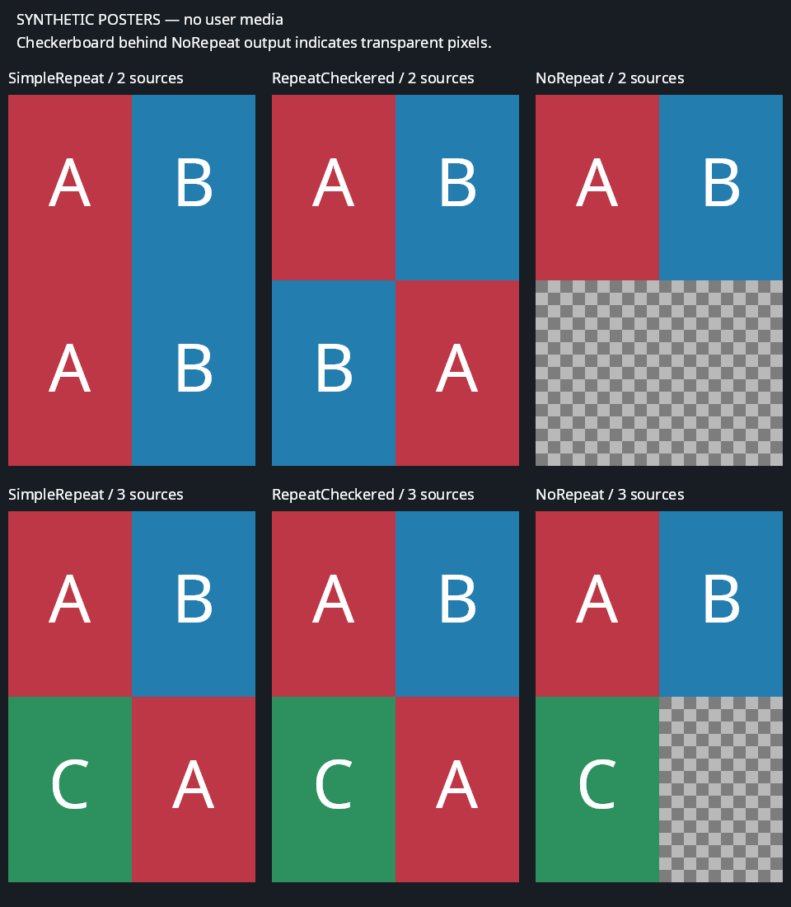

# Collection Image Generator for Jellyfin

A server-side Jellyfin **12.4** plugin that builds portrait collection covers from a **2×2 collage** of member posters. Built from scratch, with no external image service, API key, or AI model.

## Features

- 1000×1500 portrait PNG covers, proportional cover-cropping, no stretching.
- Select four distinct items by **release date**, **alphabetical title**, or **stable random** order. Stable random doesn't shuffle on every run.
- Choose how to fill collections with fewer than four usable posters: **Simple repeat** (default), **Repeat checkered**, or **Do not repeat** with transparent unused quadrants. Empty collections clear only verified, unchanged plugin-generated artwork.
- Optional centered text with **top**, **middle**, or **bottom** placement, word wrapping, and a dark readability band. `{name}` inserts the collection title; a custom template is supported.
- Bundled font, so text doesn't depend on fonts installed in the Docker image.
- Automatic scheduled generation, a **Generate now** button, configurable after-library-scan generation, and debounced updates when collections are created or their membership changes.
- Content-based fingerprints avoid unnecessary rewrites when inputs have not changed.
- **Existing artwork is preserved by default.** Only missing artwork or an unchanged image previously generated by this plugin can be updated. A separate opt-in setting allows replacing other artwork.

## Example output

Synthetic posters only; no real server or media-library data is shown. This example uses bottom-positioned, wrapped title text. Top, middle, and no-text examples are also in `docs/`.


## Installation: Jellyfin plugin repository (recommended)

**Back up your Jellyfin configuration first.** This plugin targets Jellyfin **12.4** and requires a restart after installation. The repository becomes available after the first tagged release has been published and its public downloads verified; a green CI build alone does not publish it.

1. Open **Dashboard → Plugins → Repositories** and add a repository named **Collection Image Generator** with this URL:

   ```text
   https://raw.githubusercontent.com/everyonesoftware/collection-image-generator-jellyfin-plugin/repository/manifest.json
   ```

2. Save, open the **Catalog** tab, select **Collection Image Generator**, and install the compatible stable version.
3. Restart Jellyfin, then open **Dashboard → Plugins → Collection Image Generator**.
4. Leave **Overwrite existing collection artwork** disabled. First test with a disposable Jellyfin instance/library containing a collection with no primary image, then inspect **Dashboard → Scheduled Tasks → Generate collection images** and the Jellyfin log before using it broadly. The task processes all eligible collections, not just the selected one. Automatic after-scan and collection-change generation are enabled by default; use a disposable instance before scanning or editing real collections.

Releases include a versioned installation ZIP, a SHA-256 checksum, and a snapshot of the Jellyfin manifest. The stable repository retains older versions; its manifest uses Jellyfin's required MD5 archive checksum. Maintainer publication and recovery instructions are in [docs/releases.md](docs/releases.md).

## Manual fallback: Docker Desktop on Windows

**Back up your Jellyfin `/config` volume first.** Use a disposable Jellyfin instance/library for the initial test, with a collection that has no primary image. The task processes all eligible collections. Installing a plugin requires a Jellyfin restart.

1. Download the ZIP and matching `.zip.sha256` from a published release, or build the package below. GitHub Actions artifacts are development packages, not a catalog installation.
2. Verify the ZIP's SHA-256 against the checksum file (for example, `Get-FileHash .\collection-image-generator-<version>.zip -Algorithm SHA256` in PowerShell). Extract it into `CollectionImageGenerator_<assembly-version>`; replace the placeholders with the release values. For example, package version `0.1.0` uses directory `CollectionImageGenerator_0.1.0.0`.
3. Copy that directory into Jellyfin's `/config/plugins/` directory. With a bind mount, use its Windows host directory. With a named volume, use `docker cp`:

   ```powershell
   # Replace jellyfin with your actual container name.
   # Run from the directory containing the extracted plugin directory.
   docker cp .\CollectionImageGenerator_0.1.0.0 jellyfin:/config/plugins/
   docker restart jellyfin
   ```

   You should end up with:

   ```text
   /config/plugins/CollectionImageGenerator_0.1.0.0/
     CollectionImageGenerator.Plugin.dll
     CollectionImageGenerator.Core.dll
     LICENSE
     THIRD-PARTY-NOTICES.txt
   ```

4. Open **Dashboard → Plugins → Collection Image Generator** and configure it.
5. Leave **Overwrite existing collection artwork** disabled unless you explicitly want to replace existing collection posters. Automatic after-scan and collection-change generation are enabled by default; use a disposable instance before scanning or editing real collections.
6. Save settings, then click **Generate now** on the plugin settings page to request one run. Check **Dashboard → Scheduled Tasks → Generate collection images** for progress/results and the Jellyfin log for the total/failure summary.

Jellyfin's container user needs read access to the source posters and write access to its configuration/metadata/plugin-data directories. The plugin uses paths inside the container, not Windows host paths. No additional media volume mount is required if Jellyfin can already read the posters.

The archive deliberately **does not** ship Jellyfin, .NET, or SkiaSharp assemblies/native libraries; the Jellyfin 12.4 host provides those. Do not copy the entire build output directory into `/config/plugins`.

## Settings

| Setting | Default | Meaning |
|---|---|---|
| Enabled | On | Allow generation |
| Run after library scan | On | Generate after a completed scan |
| Regenerate when collection contents change | On | Recheck only affected collections after creation, additions, or removals; combine rapid edits after about five quiet seconds |
| Poster selection | Release date | Earliest release first, alphabetical, or stable random |
| Fewer than four items | Simple repeat | Repeat sequentially, use a two-poster checkerboard, or leave unused quadrants transparent |
| Add text | Off | Draw the configured title text |
| Text template | `{name}` | Collection title, custom text, or both |
| Text placement | Bottom | Top, middle, or bottom |
| Font size | 80 | Starting size; long text is fitted to the available area |
| Replace existing artwork | Off | Explicitly permit overwriting artwork not owned by this plugin |

The scheduler's recurrence is managed in Jellyfin's Scheduled Tasks screen. Saving settings does not immediately rewrite your entire collection library. To request one run, save any edits and click **Generate now** in the **Run once** section. It uses saved settings, respects artwork protection, and processes all eligible collections without changing scheduled triggers. The plugin must be enabled in saved settings. The page reports an already-running/cancelling task or a request failure; **Generation requested** is not a completion result. Monitor progress and results in Scheduled Tasks.

### Automatic collection-content updates

**Regenerate when collection contents change** is enabled by default, including when an older configuration does not contain the setting. The plugin listens for Jellyfin's collection-created, items-added, and items-removed events. It queues only the affected collection IDs, combines rapid edits after about five seconds without another edit to that collection, then runs the same safe image-generation pipeline in the background. Membership edits do not wait for rendering, and pending work is canceled when Jellyfin shuts down.

The fingerprint still decides whether a new poster is needed. Adding an item that does not change the selected posters does not cause an unnecessary rewrite. Custom artwork is preserved unless overwrite has explicitly been enabled. If a collection is genuinely empty, its primary image is removed only when its path and bytes still match the plugin's ownership record. Custom artwork is preserved even if overwrite is enabled. A nonempty collection with unavailable or unusable posters keeps its current image; a deleted collection is skipped. Missing or uncertain ownership evidence never authorizes removal.

Saving this checkbox does not start a full-library run. Disable it to stop event-driven generation; manual, scheduled, and enabled post-scan runs remain independent fallbacks. Changes made by integrations that bypass Jellyfin's collection events, poster downloads that finish later, and metadata-only edits may need a later scan, scheduled run, or **Generate now**. The event listener does not subscribe to its own image-save updates.

### Layouts with fewer than four posters

Quadrants are filled in reading order: top left, top right, bottom left, bottom right. Letters identify distinct usable posters; `—` is transparent space.

| Mode | One poster | Two posters | Three posters |
|---|---|---|---|
| Simple repeat (default) | `A A / A A` | `A B / A B` | `A B / C A` |
| Repeat checkered | `A A / A A` | `A B / B A` | `A B / C A` |
| Do not repeat | `A — / — —` | `A B / — —` | `A B / C —` |

Synthetic comparison (checkerboard indicates transparent pixels, not a painted background):



With four posters, all modes produce `A B / C D`. This setting applies to usable local posters, after missing/corrupt images are filtered. It does not enlarge the remaining posters or move them out of their quadrants. Optional title text and its readability band still overlay the collage, including otherwise transparent areas. Saving a different mode invalidates the generated-image cache; use **Generate now** or wait for the next automatic run to update eligible plugin-owned artwork. Custom-artwork protection is unchanged.

## Artwork protection and state

The plugin stores an ownership ledger in its Jellyfin plugin data directory. It compares the actual current image bytes with the hash recorded after its previous successful write. If you manually upload a different poster later, that poster is treated as custom and preserved. Unknown, unreadable, or remote current images are not assumed to be plugin-owned.

Keep the ownership ledger when upgrading. If it is lost, existing collages are treated as unknown artwork and preserved rather than overwritten. A corrupt/unreadable ledger fails safely instead of granting overwrite permission. For nonempty collections, the explicit overwrite option intentionally permits replacing custom artwork and should normally remain off. It never authorizes deleting custom artwork from an empty collection.

Source poster changes, selected item changes, collection-title changes, and rendering-setting changes invalidate the cached fingerprint. Nested collections are not recursively expanded. Only locally available primary posters are used; the plugin does not download missing posters. It does not alter member metadata or member artwork.

There is an unavoidable small race if a separate metadata provider, manual upload, or membership edit occurs between the final checks and the actual image save or removal. The plugin reloads and rechecks the collection and current image immediately before changing artwork, but Jellyfin does not offer an atomic comparison-and-write operation here. Avoid simultaneous artwork edits or membership changes while a generation run is finishing. Once Jellyfin's image-deletion operation begins, its deletion and metadata persistence cannot be canceled; a shutdown or cancellation may therefore leave the image removed while the previous ownership evidence is retained safely for a later run.

## Build and test

Requires the **.NET 10 SDK**, Python 3, and Node.js 24 (settings-script tests). No .NET SDK is needed inside Jellyfin's container.

```sh
dotnet restore
dotnet build --configuration Release --no-restore
dotnet test --configuration Release --no-build
python -m unittest discover -s tools -p "test_*.py" -v
node --test tools/settings.test.mjs
python tools/package_plugin.py
ARCHIVE_NAME=$(python tools/release_metadata.py --field archive_name)
VERSION=$(python tools/release_metadata.py --field version)
dotnet run --project tools/PluginLoadProbe --configuration Release --no-build -- "artifacts/$ARCHIVE_NAME"
python tools/generate_manifest.py --archive "artifacts/$ARCHIVE_NAME" --tag "v$VERSION" --output artifacts/manifest.json
```

These commands use Bash (Git Bash on Windows). The package and a SHA-256 checksum are written to `artifacts/`; `release_metadata.py` derives versions and filenames from the project metadata. Automated tests use deliberately synthetic images and temporary fixture collections; they do not access your real Jellyfin server or library. GitHub Actions builds/tests on both Linux and Windows, including the native renderer and standalone package loader. Tagged publication waits for both OS jobs and reuses the tested Linux ZIP without rebuilding it.

## Compatibility and limitations

- Targets `Jellyfin.Controller`, `Jellyfin.Common`, and `Jellyfin.Model` **12.4.0**, with .NET 10 and the host's SkiaSharp **3.119.4**.
- This is an initial plugin release. Successful compilation and automated tests are not a substitute for trying it on a disposable collection in your actual Jellyfin container.
- Collection-manager membership events trigger debounced affected-collection updates when enabled. Direct file/database edits and integrations that bypass these events are caught only by subsequent generation runs, not by this listener.
- The bundled Latin font is not a promise of full CJK, emoji, or complex-script shaping support.
- Catalog availability requires a successfully published tagged release and verified public repository feed. No live Jellyfin installation or library test is implied by CI or download verification.

## Development layout

- `src/CollectionImageGenerator.Core`: deterministic selection, rendering, and safe replacement rules.
- `src/CollectionImageGenerator.Plugin`: Jellyfin integration, settings, task hooks, and persistent ownership.
- `tests/`: core and plugin lifecycle tests.
- `tools/package_plugin.py`: minimal installation ZIP, dependency exclusion, font licensing, and checksum.
- `tools/release_metadata.py`, `tools/generate_manifest.py`, `tools/verify_repository.py`: shared release metadata, history-preserving Jellyfin manifest generation, and anonymous download verification.
- `.github/workflows/release.yml`, `docs/releases.md`: gated tagged publication and manual recovery.

## References

- [Jellyfin plugin template](https://github.com/jellyfin/jellyfin-plugin-template)
- [Jellyfin 12.4 source](https://github.com/jellyfin/jellyfin/tree/v12.4)
- [Jellyfin plugin installation documentation](https://jellyfin.org/docs/general/server/plugins/)

## License

MIT. The bundled font is licensed separately under its included SIL Open Font License.
