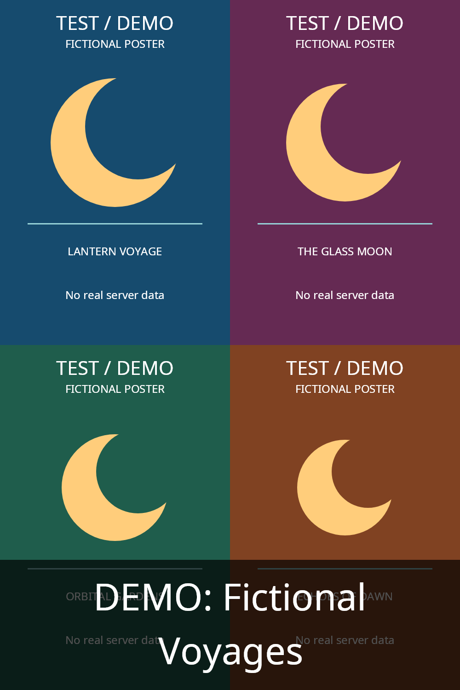

# Collection Image Generator for Jellyfin

A server-side Jellyfin **12.4** plugin that builds portrait collection covers from a **2×2 collage** of member posters. Built from scratch, with no external image service, API key, or AI model.

## Features

- 1000×1500 portrait PNG covers, proportional cover-cropping, no stretching.
- Select four distinct items by **release date**, **alphabetical title**, or **stable random** order. Stable random doesn't shuffle on every run.
- Repeat available posters for collections with fewer than four usable images. Empty collections are skipped.
- Optional centered text with **top**, **middle**, or **bottom** placement, word wrapping, and a dark readability band. `{name}` inserts the collection title; a custom template is supported.
- Bundled font, so text doesn't depend on fonts installed in the Docker image.
- Automatic scheduled generation, manual execution, and configurable after-library-scan generation.
- Content-based fingerprints avoid unnecessary rewrites when inputs have not changed.
- **Existing artwork is preserved by default.** Only missing artwork or an unchanged image previously generated by this plugin can be updated. A separate opt-in setting allows replacing other artwork.

## Example output

Synthetic posters only; no real server or media-library data is shown. This example uses bottom-positioned, wrapped title text. Top, middle, and no-text examples are also in `docs/`.



## Installation: Docker Desktop on Windows

**Back up your Jellyfin `/config` volume first.** Start with a disposable collection that has no primary image. Installing a plugin requires a Jellyfin restart.

1. Build the package below (or download the ZIP from a successful GitHub Actions build).
2. Extract `artifacts/collection-image-generator-0.1.0.zip` into a new directory named `CollectionImageGenerator_0.1.0.0`.
3. Copy that directory into Jellyfin's `/config/plugins/` directory. With a bind mount, use its Windows host directory. With a named volume, use `docker cp`:

   ```powershell
   # Replace jellyfin with your actual container name.
   # Run from the directory containing the extracted plugin directory.
   docker cp .\CollectionImageGenerator_0.1.0.0 jellyfin:/config/plugins/
   docker restart jellyfin
   ```

   You should end up with:

   ```text
   /config/plugins/CollectionImageGenerator_0.1.0.0/
     CollectionImageGenerator.Plugin.dll
     CollectionImageGenerator.Core.dll
     LICENSE
     THIRD-PARTY-NOTICES.txt
   ```

4. Open **Dashboard → Plugins → Collection Image Generator** and configure it.
5. Leave **Overwrite existing collection artwork** disabled unless you explicitly want to replace existing collection posters.
6. Open **Dashboard → Scheduled Tasks → Generate collection images** and run it once. Check the Jellyfin log for generated-image messages and the total/failure summary.

Jellyfin's container user needs read access to the source posters and write access to its configuration/metadata/plugin-data directories. The plugin uses paths inside the container, not Windows host paths. No additional media volume mount is required if Jellyfin can already read the posters.

The archive deliberately **does not** ship Jellyfin, .NET, or SkiaSharp assemblies/native libraries; the Jellyfin 12.4 host provides those. Do not copy the entire build output directory into `/config/plugins`.

## Settings

| Setting | Default | Meaning |
|---|---|---|
| Enabled | On | Allow generation |
| Run after library scan | On | Generate after a completed scan |
| Poster selection | Release date | Earliest release first, alphabetical, or stable random |
| Add text | Off | Draw the configured title text |
| Text template | `{name}` | Collection title, custom text, or both |
| Text placement | Bottom | Top, middle, or bottom |
| Font size | 80 | Starting size; long text is fitted to the available area |
| Replace existing artwork | Off | Explicitly permit overwriting artwork not owned by this plugin |

The scheduler's recurrence is managed in Jellyfin's Scheduled Tasks screen. Saving settings does not immediately rewrite your entire collection library; run the task or wait for a scheduled generation/scan.

## Artwork protection and state

The plugin stores an ownership ledger in its Jellyfin plugin data directory. It compares the actual current image bytes with the hash recorded after its previous successful write. If you manually upload a different poster later, that poster is treated as custom and preserved. Unknown, unreadable, or remote current images are not assumed to be plugin-owned.

Keep the ownership ledger when upgrading. If it is lost, existing collages are treated as unknown artwork and preserved rather than overwritten. A corrupt/unreadable ledger fails safely instead of granting overwrite permission. The explicit overwrite option intentionally bypasses ownership protection and should normally remain off.

Source poster changes, selected item changes, collection-title changes, and rendering-setting changes invalidate the cached fingerprint. Nested collections are not recursively expanded. Only locally available primary posters are used; the plugin does not download missing posters. It does not alter member metadata or member artwork.

There is an unavoidable small race with a separate metadata provider or a manual upload writing at precisely the same time as the final save. Run this task after scans and avoid concurrent collection-artwork edits. The plugin rechecks the current image immediately before saving to reduce this window.

## Build and test

Requires the **.NET 10 SDK**, Python 3, and Node.js 24 (settings-script tests). No .NET SDK is needed inside Jellyfin's container.

```sh
dotnet restore
dotnet build --configuration Release --no-restore
dotnet test --configuration Release --no-build
python -m unittest discover -s tools -p "test_*.py" -v
node --test tools/settings.test.mjs
python tools/package_plugin.py
dotnet run --project tools/PluginLoadProbe --configuration Release --no-build -- artifacts/collection-image-generator-0.1.0.zip
```

The package and a SHA-256 checksum are written to `artifacts/`. Automated tests use deliberately synthetic images and temporary fixture collections; they do not access your real Jellyfin server or library. GitHub Actions builds/tests on both Linux and Windows, including the native renderer.

## Compatibility and limitations

- Targets `Jellyfin.Controller`, `Jellyfin.Common`, and `Jellyfin.Model` **12.4.0**, with .NET 10 and the host's SkiaSharp **3.119.4**.
- This is an initial plugin release. Successful compilation and automated tests are not a substitute for trying it on a disposable collection in your actual Jellyfin container.
- Built-in daily generation does not mean immediate generation after an individual membership edit; run the scheduled task manually or wait for the next task/scan.
- The bundled Latin font is not a promise of full CJK, emoji, or complex-script shaping support.
- Manual installation only; a published Jellyfin plugin-catalog feed is not included in this initial release.

## Development layout

- `src/CollectionImageGenerator.Core`: deterministic selection, rendering, and safe replacement rules.
- `src/CollectionImageGenerator.Plugin`: Jellyfin integration, settings, task hooks, and persistent ownership.
- `tests/`: core and plugin lifecycle tests.
- `tools/package_plugin.py`: minimal installation ZIP, dependency exclusion, font licensing, and checksum.

## References

- [Jellyfin plugin template](https://github.com/jellyfin/jellyfin-plugin-template)
- [Jellyfin 12.4 source](https://github.com/jellyfin/jellyfin/tree/v12.4)
- [Jellyfin plugin installation documentation](https://jellyfin.org/docs/general/server/plugins/)

## License

MIT. The bundled font is licensed separately under its included SIL Open Font License.
